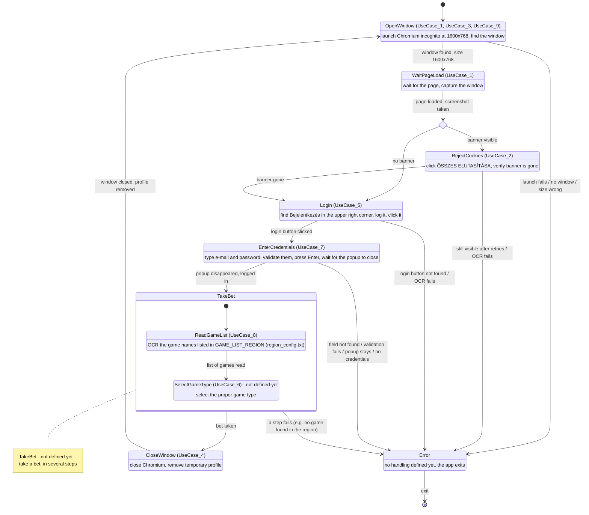

# Use Cases

Use cases for `the_app_AI`, each with the state machine designed to meet it.
This file is the single source of truth for use cases; general requirements
live in `../../description.md`.

> **Note (future architecture):** the app will move to a state model
> architecture in which each use case becomes a state. Keep each use case
> self-contained, with clear entry conditions (preconditions), an exit
> condition (success) and failure outcomes, so it can later map directly
> to a state and its transitions.
>
> Planned cycle: the first state opens the browser window (UseCase_1,
> UseCase_3), the following states do the work (e.g. take a bet), and the
> last state always closes the window (UseCase_4) before returning to the
> first state. Reloading the page = closing and reopening the browser.

## State machine

The diagram below is **generated**; do not edit it by hand. States and
transitions are defined in [`state_machine.yaml`](state_machine.yaml).
Whenever a use case/state is added or modified:

1. update `state_machine.yaml` (every `UseCase_N` must be covered by a state),
2. run `python the_app_AI/tools/gen_state_diagram.py` (needs PyYAML).

The git pre-commit hook regenerates it automatically, and the CI check
(`.github/workflows/state-diagram.yml`) fails if it is out of date.
GitHub renders the Mermaid block as a picture.

<!-- BEGIN GENERATED STATE MACHINE -->
<!-- Generated from docs/state_machine.yaml by tools/gen_state_diagram.py. Do not edit by hand. -->



| State | Use cases | Description |
|---|---|---|
| OpenWindow | UseCase_1, UseCase_3, UseCase_9 | launch Chromium incognito at 1600x768, find the window |
| WaitPageLoad | UseCase_1 | wait for the page, capture the window |
| BannerVisible | – | decision |
| RejectCookies | UseCase_2 | click ÖSSZES ELUTASÍTÁSA, verify banner is gone |
| Login | UseCase_5 | find Bejelentkezés in the upper right corner, log it, click it |
| EnterCredentials | UseCase_7 | type e-mail and password, validate them, press Enter, wait for the popup to close |
| TakeBet | – | take a bet, in several steps (composite, starts in ReadGameList) *(not defined yet)* |
| TakeBet / ReadGameList | UseCase_8 | OCR the game names listed in GAME_LIST_REGION (region_config.txt) |
| TakeBet / SelectGameType | UseCase_6 | select the proper game type *(not defined yet)* |
| CloseWindow | UseCase_4 | close Chromium, remove temporary profile |
| Error | – | no handling defined yet, the app exits |

| From | Event / guard | To |
|---|---|---|
| OpenWindow | window found, size 1600x768 | WaitPageLoad |
| OpenWindow | launch fails / no window / size wrong | Error |
| WaitPageLoad | page loaded, screenshot taken | BannerVisible |
| BannerVisible | banner visible | RejectCookies |
| BannerVisible | no banner | Login |
| RejectCookies | banner gone | Login |
| RejectCookies | still visible after retries / OCR fails | Error |
| Login | login button clicked | EnterCredentials |
| Login | login button not found / OCR fails | Error |
| EnterCredentials | popup disappeared, logged in | TakeBet |
| EnterCredentials | field not found / validation fails / popup stays / no credentials | Error |
| TakeBet | bet taken | CloseWindow |
| TakeBet | a step fails (e.g. no game found in the region) | Error |
| ReadGameList | list of games read | SelectGameType |
| CloseWindow | window closed, profile removed | OpenWindow |
| Error | exit | [*] |

<!-- END GENERATED STATE MACHINE -->

## Entry template

```
## UseCase_N: <short title>
**Status:** captured | designed | implemented
**Description:** <the use case as described>
**Preconditions:** <what must be true before it starts>
**Steps / expected behaviour:** <numbered list>
**Success:** <end condition>
**Failure / edge cases:** <timeouts, missing elements, popups, ...>
**State machine:** <state(s) covering it in state_machine.yaml; see "State machine" above>
**Notes / open questions:**
```

---

## UseCase_1: Open a webpage, screenshot it, show it in GIMP
**Status:** implemented
**Description:** Start the app from a terminal with a webpage URL as the argument. The app launches Chromium on that page, takes a screenshot of the page content in the browser window, and opens the screenshot in GIMP.
**Preconditions:** X11 session (not Wayland); chromium, xdotool, imagemagick and gimp installed.
**Steps / expected behaviour:**
1. `the_app_AI [url] [output.png]`. `url` defaults to `https://www.tippmixpro.hu`, `output.png` to `./screenshot.png`.
2. Launch Chromium on `url` in an incognito window (UseCase_9).
3. Find the window with `xdotool` and activate it.
4. Capture the window with ImageMagick `import`.
5. Open the screenshot in `gimp`.
**Success:** The screenshot of the page is open in GIMP.
**Failure / edge cases:** Wayland session or no display detected (exit with an error). Chromium window not found. Screenshot capture fails.
**State machine:** not designed yet.
**Notes / open questions:** UseCase_2 runs between steps 4 and 5.

## UseCase_2: Reject cookie banner
**Status:** captured
**Description:** When the page opens, click "ÖSSZES ELUTASÍTÁSA" on the cookie banner. Continue only if that succeeds.
**Preconditions:** Chromium window found, page loaded.
**Steps / expected behaviour:**
1. Capture the window and run OCR on it.
2. If the banner is visible, click the reject button.
3. Re-capture and check that the banner is gone.
**Success:** The banner is not visible, or was never shown.
**Failure / edge cases:** The banner is still visible after the retries are used up. OCR fails.
**State machine:** not designed yet. The draft flow from the lecture covers it (`WaitPageLoad → ◇ → RejectCookies → SelectButtonA`).
**Notes / open questions:** The user said "összes megtagadása", but the code uses "ÖSSZES ELUTASÍTÁSA". Check which label the site shows.
A first version is already in the code (see "How the screenshot is read" in `../README.md`). There an OCR failure is only a warning and the run continues, which does not match "continue only if that succeeds" above.

## UseCase_3: Open the browser window at a fixed size
**Status:** implemented
**Description:** When the browser window is opened, it must always open at a predefined size: 1600x768 (originally 1024x768, changed on request).
**Preconditions:** X11 session; Chromium is being launched by UseCase_1.
**Steps / expected behaviour:**
1. Launch Chromium with `--window-size=1600,768` and `--window-position=0,0`.
2. After the window is found, read its size with `xdotool getwindowgeometry --shell`.
3. If the size differs, set it with `xdotool windowsize` and check again (up to 3 tries).
**Success:** The window is 1600x768 before the page-load wait and the first screenshot, so every screenshot is 1600x768.
**Failure / edge cases:** The window manager overrides the size or keeps the window maximized. If the size is still wrong after the tries, the app exits with an error.
**State machine:** not designed yet.
**Notes / open questions:** The size is the outer Chromium window, meaning the X11 window that xdotool reports and ImageMagick `import` captures. Window-manager decorations around it are not counted. The size is defined by `kWindowSize` in `src/main.cpp`.
Test: `tests/test_window_size.cpp` (`BrowserWindow.OpensInPredefinedWindowSize`) launches Chromium and checks WIDTH/HEIGHT from `xdotool getwindowgeometry --shell`. It is skipped without an X11 session, chromium or xdotool.

## UseCase_4: Close the browser window
**Status:** captured
**Description:** Reloading the page is done by restarting the browser: after every bet taken, the browser window is closed and then reopened, starting again from the beginning. This use case closes the browser window. In the state model it is always the last state of a cycle, right before returning to the first state, where the window is opened (UseCase_1 / UseCase_3).
**Preconditions:** The browser was launched by the app (its pid and window id are known). The work of the cycle is done (e.g. a bet was taken).
**Steps / expected behaviour:**
1. Close the Chromium window gracefully (e.g. `xdotool windowclose` or SIGTERM to the Chromium process group).
2. Wait until the window is gone (`xdotool search --pid` finds nothing) and the process has exited.
3. If it is still running after a timeout, kill it (SIGKILL).
4. Remove the temporary Chromium profile (`/tmp/the_app_AI_profile_<pid>`).
5. Hand over to the first state: open the window again.
**Success:** No window or process of the launched Chromium remains, the temporary profile is removed, and the next cycle can start from a clean state.
**Failure / edge cases:** The window does not close (hung page, dialog such as "Leave site?"). The process does not exit even after SIGKILL. The window was already closed (e.g. crashed): treat as success.
**State machine:** not designed yet. Cycle: `OpenWindow → ... → TakeBet → CloseWindow → OpenWindow`.
**Notes / open questions:** The "take a bet" use case does not exist yet. Should failures in other states also go through CloseWindow before restarting? Should the cycle repeat forever, or stop after a number of bets? Today the app leaves Chromium running when it exits.

## UseCase_5: Login button
**Status:** implemented
**Description:** Before taking a bet the user must log in. There is a "Bejelentkezés" button in the upper right corner of the page. Look for that button in the upper right corner; if found, report it and click it. These actions are logged for monitoring purposes.
**Preconditions:** The page is loaded in the 1600x768 window (UseCase_3) and the cookie banner is handled (UseCase_2). A fresh browser profile is used every cycle, so the user is expected to be logged out.
**Steps / expected behaviour:**
1. Capture the window and run OCR on it.
2. Search for "Bejelentkezés" only in the upper right corner: the right half of the window and its top 20% (800x153 px at 800,0 of the 1600x768 window).
3. If found, log that it was found and where (click point and box), then click its center.
4. Wait, re-capture the window and log that the button was clicked.
**Success:** The button was found in the upper right corner and clicked. Next: EnterCredentials (UseCase_7).
**Failure / edge cases:** The button is not found in the upper right corner (logged, then Error: being logged in already is not expected). OCR, capture or click fails (logged, then Error). The same word elsewhere on the page is ignored.
**State machine:** `Login` (see "State machine" above).
**Notes / open questions:** Every step is written with a timestamp to `the_app_AI.log` (next to the working directory) and to the terminal. The login popup after the click is handled by UseCase_7.

## UseCase_6: Select game type
**Status:** captured
**Description:** Taking a bet consists of several states. The first one is to select the proper game type.
**Preconditions:** The user is logged in (UseCase_5, UseCase_7) and the list of games has been read (UseCase_8).
**Steps / expected behaviour:** not defined yet.
**Success:** The proper game type is selected.
**Failure / edge cases:** not defined yet (e.g. game type not found).
**State machine:** `TakeBet / SelectGameType`, the second sub-state of the composite state `TakeBet` (after `ReadGameList`).
**Notes / open questions:** Which game type is "proper", and how is it chosen (fixed, argument, configuration)? Where is it on the page? What are the next sub-states of TakeBet?

## UseCase_7: Enter login credentials
**Status:** implemented
**Description:** After "Bejelentkezés" is clicked (UseCase_5) a login popup appears. Enter the e-mail address and the password there. OCR finds out where each one has to be written. After typing, a screenshot validates each field: the e-mail address must be readable in its field, and the password field (which shows dots, not the password) must show exactly as many dots as the password has characters.
**Preconditions:** The login popup is open (UseCase_5). `credentials.env` (gitignored; template: `credentials.env.example`) holds `EMAIL` and `PASSWORD`. Another file can be given with `THE_APP_AI_CREDENTIALS`. The file is read at start-up, so a missing file stops the app before the browser opens.
**Steps / expected behaviour:**
1. Capture the window and run OCR. Find the label "Felhasználónév vagy e-mail cím" (fallback: "e-mail cím"), and the label "Jelszó" below it.
2. Find the outlined input field directly below each label in the screenshot pixels. Log both field positions.
3. Click the e-mail field and type the e-mail address (`xdotool type`).
4. Take a screenshot. Validate that the OCR text inside the e-mail field matches the e-mail address (case/accent/punctuation-insensitive, small OCR errors allowed). Log the OCR result.
5. The password field is still empty (no dots). Take note of anything dot-like already visible in it, e.g. the "eye" icon, so it is not counted as a password dot later.
6. Click the password field and type the password.
7. Take a screenshot. Count the new dots in the password field; the count must equal the length of the password. Log only the counts, never the password.
8. Press Enter (`xdotool key Return`) to submit the login.
9. Every second, take a screenshot and run OCR, for at most 10 seconds. The login succeeded when the popup has disappeared, i.e. its field labels can no longer be read.
**Success:** Both fields are filled and validated, and the popup disappeared after Enter (logged in). Next: TakeBet.
**Failure / edge cases:** The credentials file is missing or incomplete; a label or field is not found; typing fails; the e-mail OCR text does not match; the dot count is wrong; the popup is still visible 10 seconds after Enter (e.g. wrong password). All of these are logged and lead to Error.
**State machine:** `EnterCredentials` (see "State machine" above).
**Notes / open questions:** Not tested against the live site yet. The reference picture (`docs/login_popup.png`) comes from a mobile browser, so the desktop popup at 1600x768 may look different. `xdotool type` depends on the X keyboard layout ("@" on a Hungarian layout). Not checked yet: an error message in the popup (e.g. wrong password) is only seen as "popup still visible". The login is submitted with Enter, not by clicking the "BEJELENTKEZÉS" button of the popup.

## UseCase_8: Read the list of games
**Status:** implemented
**Description:** After a successful login, the game type to bet on has to be identified. The games are listed horizontally in a region of the screen. Read the list of games in that region. The position of the region comes from a config file.
**Preconditions:** The user is logged in (UseCase_7). `region_config.txt` (working directory, or the file named by `THE_APP_AI_REGION_CONFIG`) contains `GAME_LIST_REGION = [left,top] [width,height]`, in pixels of the 1600x768 window, e.g. `GAME_LIST_REGION = [0,0] [500,100]` ([0,0] is the upper left corner, 500 the width, 100 the height). The file is read at start-up; a missing file, a missing or malformed entry, or a region outside the window stops the app before the browser opens.
**Steps / expected behaviour:**
1. Capture the window.
2. Run OCR on that region only: the screenshot is cropped first, so the rest of the page cannot disturb the result.
3. Group the words into games: rows top to bottom, games left to right. Words separated by a normal word space belong to the same game (e.g. "Élő fogadás"); a wider gap starts the next game. Icon noise such as "|" or "•" is dropped.
4. Log the number of games and each game with its position (click point and box).
**Success:** At least one game was read. Next: SelectGameType (UseCase_6).
**Failure / edge cases:** The region contains no readable text (wrong region, page not loaded, OCR fails). This is logged and leads to Error.
**State machine:** `TakeBet / ReadGameList`, the first sub-state of the composite state `TakeBet`.
**Notes / open questions:** The real position of the game list at 1600x768 is not known yet; `[0,0] [500,100]` is a placeholder. Games shown only as icons (no text) cannot be read by OCR. If the list is wider than the window (scrolling), only the visible games are read.

## UseCase_9: Open the page in incognito mode
**Status:** implemented
**Description:** The browser must open the webpage in incognito (private) mode.
**Preconditions:** Chromium is being launched by UseCase_1.
**Steps / expected behaviour:**
1. Launch Chromium with `--incognito`, and the url as a normal argument (after `--`, so it can never be taken for a switch).
2. Keep the other launch options: dedicated profile directory, `--window-size=1600,768`, `--window-position=0,0`, X11.
**Success:** The page is shown in an incognito window: no cookies, history or cache are kept after the window is closed.
**Failure / edge cases:** Chromium fails to start or no window appears (as in UseCase_1, leads to Error).
**State machine:** `OpenWindow` (see "State machine" above).
**Notes / open questions:** App mode (`--app=<url>`, a window without tabs and address bar) was dropped, because app windows may ignore `--incognito`. The window now has tabs and an address bar, so the page content starts lower in the 1600x768 window. Screenshots and clicks still use window coordinates, so they keep working, but regions in `region_config.txt` must be measured on a screenshot of the incognito window. Test: `tests/test_browser.cpp` (`ChromiumOpensUrlInIncognitoWindowAtGivenSize`) checks the launch command.
